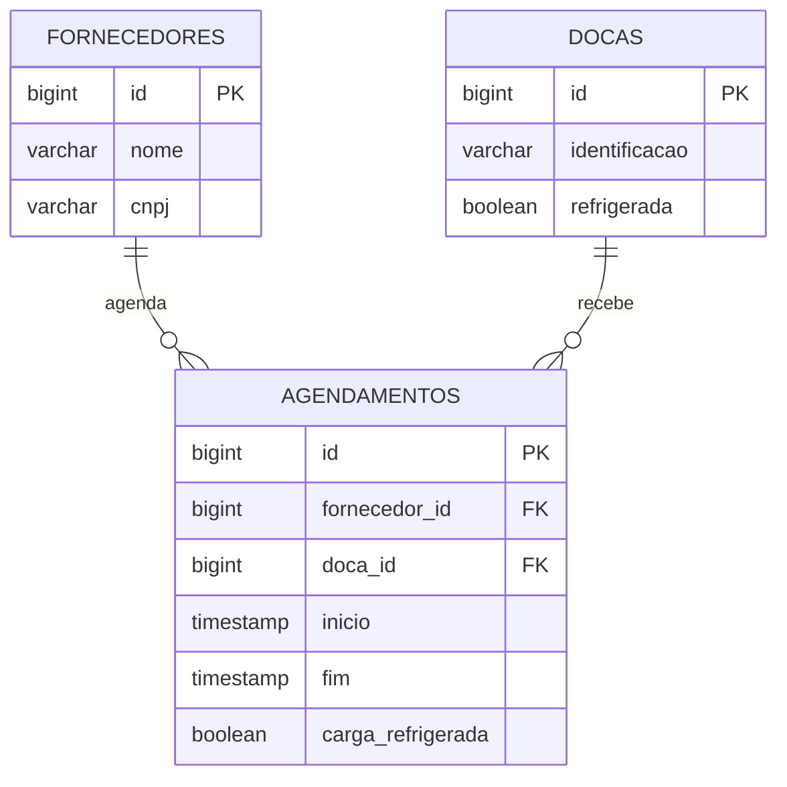

# Modelo de domínio

## Entidades

### Doca

Um portão do centro de distribuição onde um caminhão encosta para descarregar.

| Atributo | Tipo Java | Coluna | Obrigatório | Regra |
|---|---|---|---|---|
| `id` | `Long` | `id` | sim | Gerado pelo banco |
| `identificacao` | `String` | `identificacao` | sim | Até 20 caracteres. Como a doca é chamada no pátio, por exemplo `D-01` |
| `refrigerada` | `boolean` | `refrigerada` | sim | Diz se a doca tem câmara fria. Usado pela regra R2 |

### Fornecedor

Uma empresa que entrega mercadoria no centro de distribuição.

| Atributo | Tipo Java | Coluna | Obrigatório | Regra |
|---|---|---|---|---|
| `id` | `Long` | `id` | sim | Gerado pelo banco |
| `nome` | `String` | `nome` | sim | Até 255 caracteres |
| `cnpj` | `String` | `cnpj` | sim | Até 18 caracteres, no formato `00.000.000/0000-00` |

### Agendamento

A reserva de uma doca, num horário, para a descarga de um fornecedor.

| Atributo | Tipo Java | Coluna | Obrigatório | Regra |
|---|---|---|---|---|
| `id` | `Long` | `id` | sim | Gerado pelo banco |
| `fornecedor` | `Fornecedor` | `fornecedor_id` | sim | O fornecedor precisa existir |
| `doca` | `Doca` | `doca_id` | sim | A doca precisa existir, estar livre no horário (R1) e ser refrigerada se a carga for (R2) |
| `inicio` | `LocalDateTime` | `inicio` | sim | Pelo menos 24 horas depois do momento do agendamento (R3) |
| `fim` | `LocalDateTime` | `fim` | sim | Depois do `inicio` |
| `cargaRefrigerada` | `boolean` | `carga_refrigerada` | sim | Diz se a carga precisa de câmara fria (R2) |

As regras R1, R2 e R3 ficam no `AgendamentoService`. O banco só guarda os dados: não tem `CHECK`, `UNIQUE` nem trigger com regra de negócio.

## Relacionamentos

| De | Para | Tipo | No banco | No código |
|---|---|---|---|---|
| Agendamento | Fornecedor | muitos para um | `agendamentos.fornecedor_id` referencia `fornecedores(id)` | `@ManyToOne` em `Agendamento` |
| Agendamento | Doca | muitos para um | `agendamentos.doca_id` referencia `docas(id)` | `@ManyToOne` em `Agendamento` |

## Diagrama ER

Como ler: `||--o{` é "um para muitos". Um fornecedor faz zero ou vários agendamentos, e cada agendamento é de exatamente um fornecedor. O mesmo vale para doca e agendamento: uma doca recebe vários agendamentos, em horários diferentes.

## Migrations

Todas existem em `src/main/resources/db/migration`, uma tabela por arquivo.

| Versão | Arquivo | O que cria |
|---|---|---|
| V1 | `V1__criar_docas.sql` | Tabela `docas` |
| V2 | `V2__criar_fornecedores.sql` | Tabela `fornecedores` |
| V3 | `V3__criar_agendamentos.sql` | Tabela `agendamentos`, com as duas chaves estrangeiras |
